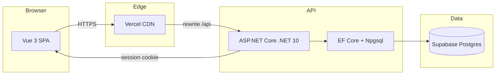

# StockFlow — From Request to Receipt

[](https://opensource.org/licenses/MIT)
[](https://dotnet.microsoft.com/)
[](https://vuejs.org/)
[](https://www.postgresql.org/)
[](https://www.docker.com/)
[](https://github.com/siliconsagenerd/stockflow)

**A procurement and inventory workflow prototype.** StockFlow tracks the complete
journey from material request through manager approval, purchase order creation,
partial and final goods receipt, to workspace-scoped stock balances and movement
history. Built for the dinext Working Student Developer application.

Live demo: https://stockflow-frontend-mauve.vercel.app/
Demo identities are simulated — not real authentication.



## Features

- **Request creation** — product selection, positive quantity, optional justification
- **Manager approval / rejection** — self-approval blocked, only Pending transitions
- **Atomic purchase orders** — created on approval, unique constraint on request
- **Partial & final goods receipt** — 6 then 4 units, serializable isolation
- **Workspace-scoped inventory** — balances and movement history per workspace
- **Receipt idempotency** — same key + payload returns original; conflicting key rejected
- **Anonymous sessions** — HttpOnly cookie, SHA-256 hashed, 8h expiry
- **Overview dashboard** — metrics, recent activity, demo guide
- **Responsive UI** — desktop and mobile layouts

## Stack

| Layer | Technology |
|---|---|
| Backend | ASP.NET Core / .NET 10, EF Core 10, Npgsql |
| Frontend | Vue 3 + TypeScript (Vite) |
| Database | PostgreSQL 16 (Supabase) |
| Tests | xUnit (integration, real Postgres), Playwright (browser) |
| Deploy | Vercel (frontend), Oracle Cloud (API), Supabase (DB) |

## Local Development

### Prerequisites

- .NET 10 SDK
- Node 20+
- PostgreSQL 16 (dedicated `stockflow` / `stockflow_test` databases)

### Backend

```bash
cd backend/StockFlow.Api
ASPNETCORE_ENVIRONMENT=Development dotnet run --urls http://127.0.0.1:5050
```

### Frontend

```bash
cd frontend
npm install
npm run dev
```

Open http://127.0.0.1:5173 (Vite proxies `/api` and `/health` to the API).

### Tests

```bash
# Set connection string (stored locally, not committed)
export STOCKFLOW_TEST_DB_CONNECTION="$(cat ~/.stockflow-test-conn)"
cd backend && dotnet test
```

31 test methods (9 RequestCreation + 10 Approval + 11 Receipt + 1 Health).

Frontend build:

```bash
cd frontend && npm run build
```

## Architecture

### Data Model

Product, Supplier, Warehouse, DemoUser, DemoWorkspace, DemoSession, PurchaseRequest,
PurchaseOrder, GoodsReceipt, StockBalance, StockMovement.

Constraints: unique Sku, unique PurchaseOrder.PurchaseRequestId, unique
GoodsReceipt.IdempotencyKey (scoped to workspace), unique DemoSession token hash.

### Session Scope

- Visitor calls `POST /api/session` once; server creates a DemoWorkspace + DemoSession.
- All reads/writes resolve workspace from the validated session cookie.
- Caller-supplied workspace IDs are ignored.
- Cookie: HttpOnly, SameSite=Strict, Secure in production, 8-hour expiry.

### Transaction Boundaries

- **Approval**: conditional `ExecuteUpdateAsync` with `WHERE status='Pending'` +
  unique constraint on `PurchaseOrder.PurchaseRequestId` + transaction.
- **Receipt**: Serializable isolation + conditional updates + idempotency key check.

### Concurrency Guards

- Approval: row-level lock via conditional update.
- Receipt: Serializable isolation prevents phantom reads; conflicting transactions
  return HTTP 409 (retryable).
- Unique constraints on idempotency keys prevent duplicate receipts.

### Idempotency Conflict/Replay

- Same key + same payload → returns original receipt.
- Same key + different payload → HTTP 409 Conflict.
- Concurrent conflicting transactions → HTTP 409 (retryable, preserve key).

## Demo Walkthrough (10 → 6 → 4)

1. Switch to **Anna Beispiel (Employee)**, create a request for 10 units.
2. Switch to **Markus Beispiel (Manager)**, approve it (creates purchase order).
3. Switch to **Werner Beispiel (Warehouse)**, open the order, receive 6.
4. Receive the remaining 4 to complete the order.
5. Verify: inventory = 10, 2 movements, overview shows 1 completed order.

## Simulated Identities vs Real Authentication

Demo roles (Employee, Manager, Warehouse) are selected via a dropdown and sent as
an `X-Demo-User` header. There are no passwords, no JWT, and no identity provider.
This is labelled "Demo identity — not secure authentication" throughout.

## Anonymous Session Limitations

- Sessions are possession-based: anyone with the cookie can access the workspace.
- 8-hour expiry, HttpOnly, SameSite=Strict, Secure in production.
- No user registration, no password recovery, no multi-device sync.

## Zero Opening Stock

All products start with zero stock. Stock enters only through goods receipts
against purchase orders. No manual stock adjustments or opening balances.

## Known Limitations

- No real SAP/ERP integration.
- No AI, no enterprise auth, no multi-warehouse, no transfers.
- MSB3277 warning (EF Core/Npgsql version skew, tracked, not suppressed).
- Supabase free tier (7-day backup retention, 500MB limit).
- Oracle Cloud free tier (short-lived deployment).
- Concurrent receipt submissions may return retryable 409 responses.
- Load test: 5 of 8 concurrent users had correct inventory; demo verified for sequential use.

## Deployment Status

Deployed 2026-10-20. Frontend on Vercel, API on Oracle Cloud, DB on Supabase.
See `docs/RUNBOOK.md` for operational details.

## License

MIT
